

  

  
  
  
  

  <b>Shadow's</b> is a custom <code>client.dll</code> for Counter-Strike 1.6. 
  It keeps the game as it is and adds an <b>Advanced</b> window to the main menu with everything below.

  <a href="#-models">Models</a> &nbsp;·&nbsp;
  <a href="#-radar">Radar</a> &nbsp;·&nbsp;
  <a href="#-fx">FX</a> &nbsp;·&nbsp;
  <a href="#-crosshair">Crosshair</a> &nbsp;·&nbsp;
  <a href="#-misc">Misc</a> &nbsp;·&nbsp;
  <a href="#-always-on">Always on</a> &nbsp;·&nbsp;
  <a href="#-install">Install</a> &nbsp;·&nbsp;
  <a href="#-build">Build</a>

---

## ▪ Models

  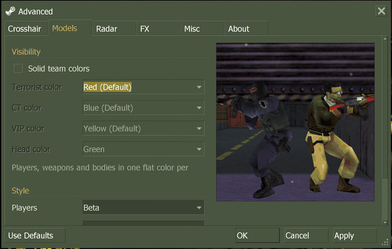

<!-- vgui-table models
| Option | What it does |
|---|---|
| **Solid team colors** | Players, their weapons and bodies in one flat color per team. Pick the Terrorist, CT and VIP colors, and a separate **head color** on top. |
| **Players** | `Original`, `Retail` (the CS 1.0 player models) or `Beta` (beta 6.1). All nine models in each set. |
| **Weapons** | `Original`, `Retail` (CS 1.5) or `Beta` (beta 6.1), in first person, in other players' hands and on the ground. A weapon a set never had keeps the game's model. |
| **Override server models** | Keeps your chosen player and weapon models when a server forces its own custom ones. |
-->
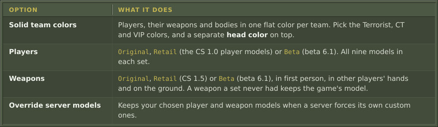

## ▪ Radar

  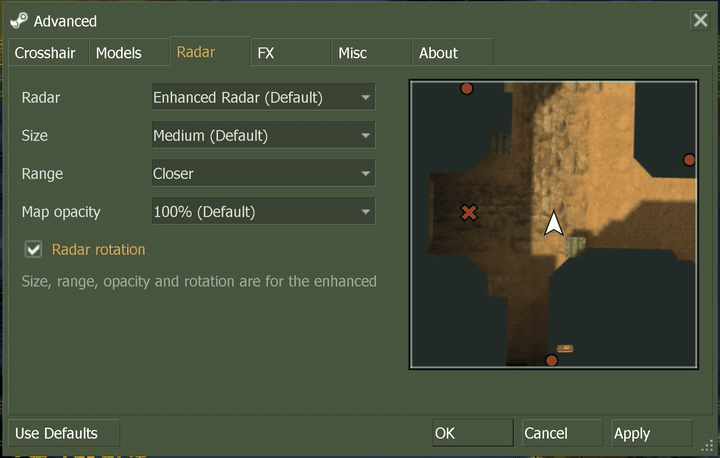

<!-- vgui-table radar
| Option | What it does |
|---|---|
| **Enhanced radar** | A square radar that shows the map's overview under the dots. `Classic radar` brings the round one back. |
| **Size / Range / Map opacity** | Four sizes, four ranges (how much of the map fits) and how solid the map picture is. |
| **Radar rotation** | Turns the map with your view, or keeps north up. |
-->
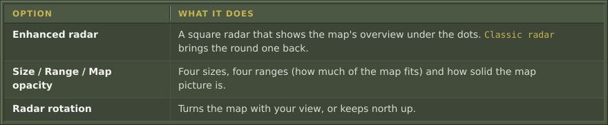

## ▪ FX

  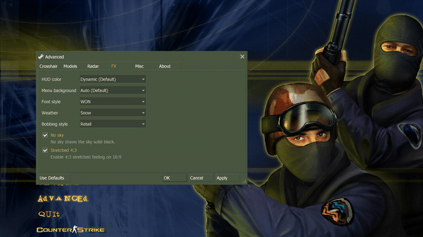

<!-- vgui-table fx
| Option | What it does |
|---|---|
| **HUD color** | Orange, white, red, green, yellow, cyan, crimson, or the animated `Rainbow`, `Christmas` and `Dynamic` (health and money colored by how much you have). |
| **Menu background** | `Original`, `Beta` or `Retail` artwork behind the main menu, or `Auto`, which goes round all three. |
| **Font style** | `WON` puts the menus in CS 1.5's fonts and the chat in the old engine's lettering. |
| **Weather** | Rain or snow on any map, outdoors. |
| **Bobbing style** | The weapon's bob as in WON Half-Life, as in the Steam versions, or as in Source. |
| **No sky** | Draws the sky solid black. |
| **Stretched 4:3** | The 4:3 stretched look on a 16:9 screen. |
-->
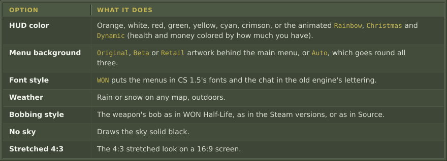

## ▪ Crosshair

  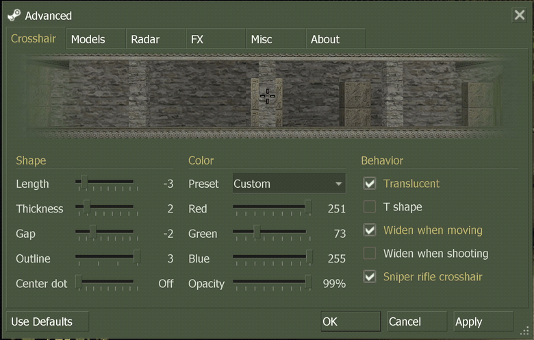

A full crosshair editor with a live preview.

<!-- vgui-table crosshair
| Group | Options |
|---|---|
| **Shape** | Length, thickness, gap, outline, center dot |
| **Color** | Presets, or any color with red / green / blue sliders, and opacity |
| **Behavior** | Translucent, T shape, widen when moving, widen when shooting, a crosshair for sniper rifles |
-->
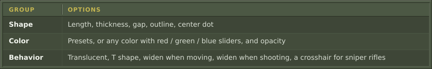

## ▪ Misc

  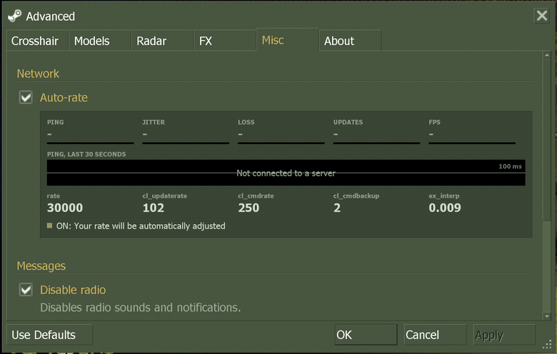

<!-- vgui-table misc
| Option | What it does |
|---|---|
| **Auto-rate** | Sets `rate`, `cl_updaterate`, `cl_cmdrate`, `cl_cmdbackup` and `ex_interp` for the server you are on, and backs off when the line loses packets. A readout shows ping, jitter, loss, updates and fps live. Your own settings come back when you switch it off. |
| **Disable radio** | No radio sounds or radio text. |
| **Hide AMXX texts** | Hides server plugins' adverts, repeated notices and info boards. Replies to something you asked stay. |
| **Auto-record demos** | Records a demo of every map on its own, named by date and server. |
| **Auto-delete** | Removes auto-recorded demos older than 5, 15, 30 or 60 days. Your own recordings are never touched. |
-->
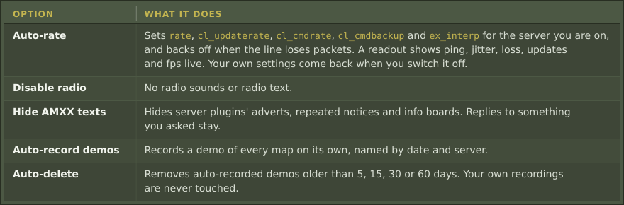

## ▪ Always on

- **Exact hit positions** – other players are drawn where the server tests your shots, not half an update behind.
- **Chat window** – a real window in place of the one-line `say:` prompt: scrollable history, text selection, copy and paste, your sent lines with the up and down keys. `hud_chat_window 0` brings the old prompt back.
- **Sharp HUD** – the original HUD, redrawn at up to four times its resolution.
- **Download counter** – how many files a server still has to send while you connect.
- **Weapon position** – `viewmodel_fov`, `viewmodel_x`, `viewmodel_y`, `viewmodel_z`.
- **Menu** – Counter-Strike's own Facelift font, CS 1.5's menu sounds, and a black screen in place of the low-resolution loading picture while the game starts.

<b>Console settings</b>

 

<!-- vgui-table settings
| Setting | Default | |
|---|---|---|
| `cl_advanced` | – | Opens the Advanced window |
| `cl_teamcolors` | `0` | Solid team colors |
| `cl_teamcolor_t` / `cl_teamcolor_ct` / `cl_teamcolor_vip` | `255 0 0` / `0 0 255` / `255 255 0` | Team colors, `r g b` |
| `cl_headcolor` | `0` | Head color, `r g b`, with solid team colors |
| `cl_playermodels` | `original` | `original`, `retail`, `beta` |
| `cl_weaponmodels` | `original` | `original`, `retail`, `beta` |
| `cl_overridemodels` | `0` | Override server models |
| `cl_radar_square` | `1` | Enhanced radar |
| `cl_radar_size` / `cl_radar_range` / `cl_radar_alpha` / `cl_radar_rotate` | `150` / `1000` / – / `1` | Enhanced radar's size, range, map opacity, rotation |
| `hud_color` | – | `r g b`, `rainbow`, `christmas` or `dynamic` |
| `cl_menubackground` | `auto` | `auto`, `original`, `beta`, `retail` |
| `cl_fontstyle` | `original` | `original`, `won` |
| `cl_weather_type` | `0` | `1` rain, `2` snow |
| `cl_bobstyle` | `won` | `won`, `retail`, `source` |
| `cl_nosky` | `0` | No sky |
| `cl_stretch43` | `0` | Stretched 4:3 |
| `cl_crosshair_length` / `_thickness` / `_gap` / `_outline` / `_dot` | `0` / `1` / `0` / `0` / `0` | Crosshair shape |
| `cl_crosshair_rgb` / `cl_crosshair_alpha` | – / `0` | Crosshair color and opacity |
| `cl_crosshair_t` / `cl_crosshair_recoil` / `cl_crosshair_sniper` | `0` / `1` / `0` | Crosshair behavior |
| `cl_autorate` | `0` | Auto-rate |
| `cl_disableradio` | `0` | Disable radio |
| `cl_hideamxx` | `0` | Hide AMXX texts |
| `cl_autorecord` / `cl_autorecord_delete` | `0` / `30` | Auto-record demos, and after how many days they go (`0` never) |
| `hud_chat_window` | `1` | The chat window |
| `hud_download_info` | `1` | The download counter |
| `hud_tier` | `0` | HUD sprites: `0` by resolution, or `640`, `1280`, `3840` |
| `viewmodel_fov` | `90` | The weapon's field of view |
| `viewmodel_x` / `viewmodel_y` / `viewmodel_z` | `0` | The weapon's position |
-->

---

## ▪ Install

You need Counter-Strike 1.6 on Steam (Windows).

1. Download the latest release from the [Releases](https://github.com/BlackShadow/ShadowsCS-Client/releases) page.
2. Close the game.
3. Open the archive and drag its `cstrike` folder into your Half-Life folder (`...\Steam\steamapps\common\Half-Life`). Say yes when Windows asks to replace files.
4. Start Counter-Strike. **Advanced** is in the main menu.

To go back to the stock client, let Steam verify the game's files.

> [!WARNING]
> The chance of getting a VAC ban from this custom client is close to zero, but you still use it at your own risk. You have been warned.

## ▪ Build

- Visual Studio with the C++ desktop workload
- Open `projects\vs2026\Shadows-CustomDLLforCS.sln`
- Build **Release | Win32**

<!-- vgui-table build
| Project | Output |
|---|---|
| `cstrike_cdll` | `bin\Win32\Release\cstrike\cl_dlls\client.dll` |
| `cstrikedll` | `bin\Win32\Release\cstrike\dlls\mp.dll` |
-->
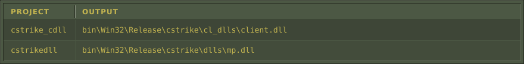

## ▪ What is in here

<!-- vgui-table what-is-in-here
| Folder | |
|---|---|
| `cstrike\` | The client and server source |
| `game\cstrike\` | The files the client needs next to it: model sets, HUD sprites, menu backgrounds, fonts |
| `projects\vs2026\` | The Visual Studio solution |
| `art\` | The crosshair banner's source picture and this page's banner |
-->
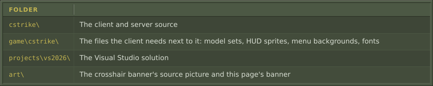

## ▪ Credits

- Built on the Half-Life SDK and [GoldSrc-SDK](https://github.com/BlackShadow/GoldSrc-SDK).
- Counter-Strike, Half-Life and their models, sprites and sounds belong to Valve.
- Made by [BlackShadow](https://github.com/BlackShadow).
